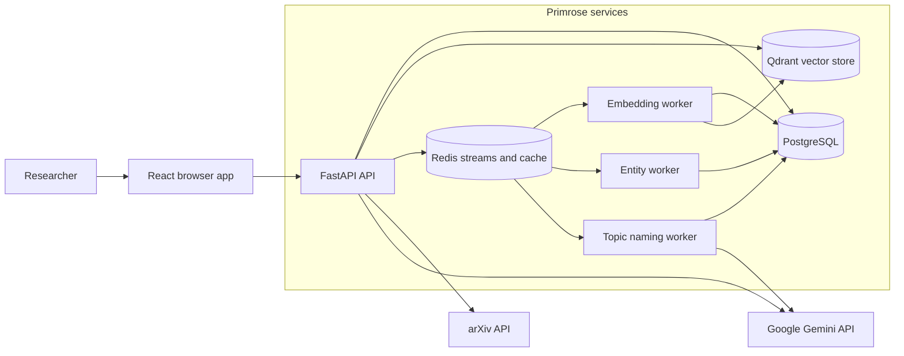

# Architecture

Last reviewed: 2026-11-11

## Overview

Primrose is a research-paper discovery application. Its React frontend talks to a FastAPI backend that searches papers semantically, serves corpus topics, and generates reading recommendations. PostgreSQL stores application records, Qdrant stores document vectors, and background workers process corpus documents outside the interactive search path.

## System Map

## Repository Tree

- [backend/](backend/) — FastAPI application and Python domain services; API routes use the service layer and PostgreSQL session factory.
    - [app/](backend/app/) — application setup, shared configuration, persistence models, schemas, and security.
        - [main.py](backend/app/main.py) — creates the FastAPI app, middleware, and router registrations.
        - [routers/](backend/app/routers/) — HTTP boundary; handlers validate requests and delegate domain work.
            - [auth.py](backend/app/routers/auth.py), [user.py](backend/app/routers/user.py) — sign-in, tokens, profile, bookmarks, and uploads.
            - [documents.py](backend/app/routers/documents.py) — document CRUD, search, bookmarks, and manual paper creation.
            - [corpora.py](backend/app/routers/corpora.py) — corpus configuration, sync requests, and sync status.
            - [entities.py](backend/app/routers/entities.py), [topics.py](backend/app/routers/topics.py) — entity and topic browse/search endpoints.
            - [recommendations.py](backend/app/routers/recommendations.py) — related-paper and reading-journey endpoints.
            - [settings.py](backend/app/routers/settings.py) — application settings endpoints.
        - [models.py](backend/app/models.py), [schemas.py](backend/app/schemas.py) — SQLAlchemy records and API request/response types.
        - [database.py](backend/app/database.py), [config.py](backend/app/config.py) — database sessions and environment-backed settings.
        - [security.py](backend/app/security.py), [secret_storage.py](backend/app/secret_storage.py) — token/password security and local secret handling.
        - [cache.py](backend/app/cache.py) — shared Redis cache client and TTL.
    - [services/](backend/services/) — domain workflows and external-service adapters, shared by routes and workers.
        - [arxiv_client.py](backend/services/arxiv_client.py), [corpus_sync.py](backend/services/corpus_sync.py) — fetch papers from arXiv and coordinate corpus ingestion.
        - [embedding_queue.py](backend/services/embedding_queue.py), [embedding_worker.py](backend/services/embedding_worker.py), [entity_worker.py](backend/services/entity_worker.py) — publish and consume Redis-stream document jobs.
        - [embed.py](backend/services/embed.py), [vector_store.py](backend/services/vector_store.py) — create text embeddings and read/write Qdrant vectors.
        - [search.py](backend/services/search.py), [reranker.py](backend/services/reranker.py) — retrieve candidates and rerank papers.
        - [recommendations.py](backend/services/recommendations.py), [gemini.py](backend/services/gemini.py) — build cached reading journeys using Gemini.
        - [entities.py](backend/services/entities.py), [aliases.json](backend/services/aliases.json) — extract, canonicalize, persist, and search paper entities.
        - [topics.py](backend/services/topics.py), [topic_worker.py](backend/services/topic_worker.py), [clusters.py](backend/services/clusters.py), [topic_naming_worker.py](backend/services/topic_naming_worker.py) — cluster corpus embeddings and name topics.
        - [app_settings.py](backend/services/app_settings.py), [prompts/](backend/services/prompts/), [send_email.py](backend/services/send_email.py) — stored settings, model prompts, and email delivery.
    - [init_schema.py](backend/init_schema.py) — schema initialization utility.
- [frontend/](frontend/) — React and TypeScript browser application, built with Vite.
    - [index.html](frontend/index.html) loads [src/main.tsx](frontend/src/main.tsx), which mounts [src/App.tsx](frontend/src/App.tsx) and its route screens.
    - [src/](frontend/src/) — [SearchScreen.tsx](frontend/src/SearchScreen.tsx), [PaperLibraryScreens.tsx](frontend/src/PaperLibraryScreens.tsx), [TopicScreens.tsx](frontend/src/TopicScreens.tsx), [EntityScreens.tsx](frontend/src/EntityScreens.tsx), [CorpusScreens.tsx](frontend/src/CorpusScreens.tsx), and [AuthScreens.tsx](frontend/src/AuthScreens.tsx) implement the main user workflows.
    - [src/components/](frontend/src/components/) — shared UI and paper-result components.
    - [src/api.ts](frontend/src/api.ts), [src/authApi.ts](frontend/src/authApi.ts), [src/api-schema.ts](frontend/src/api-schema.ts) — HTTP calls, auth calls, and generated OpenAPI types.
    - [package.json](frontend/package.json) — frontend dependencies and build, lint, and typecheck scripts.
- [alembic/](alembic/) — database migrations; [env.py](alembic/env.py), [versions/](alembic/versions/), and [baselines/](alembic/baselines/) define migration setup and schema history.
- [tests/](tests/) — pytest coverage organized by boundary.
    - [api/](tests/api/) tests HTTP routes; [services/](tests/services/) tests domain services; [integration/](tests/integration/) tests end-to-end service combinations.
    - [conftest.py](tests/conftest.py) configures shared test fixtures.
- [docker-compose.yaml](docker-compose.yaml) defines local services; [primrose-installer/docker-compose.prod.yaml](primrose-installer/docker-compose.prod.yaml) defines self-hosted production services.
- [Dockerfile](Dockerfile), [Dockerfile.worker](Dockerfile.worker), [requirements.txt](requirements.txt), and [requirements.worker.txt](requirements.worker.txt) define the API and worker images and Python dependencies.

## Data Flow

**Semantic search:** The frontend sends a query to `GET /documents/search`. The API embeds the query with Sentence Transformers, searches Qdrant (optionally filtering by corpus and entity), fetches matching document records from PostgreSQL, then reranks candidates with a Cross-Encoder. The API returns the ranked papers to the frontend.

**Corpus sync (arXiv ingestion):** `POST /corpora/{id}/sync` records a sync and starts it in the API process. [`corpus_sync.py`](backend/services/corpus_sync.py) fetches papers from arXiv, stores documents and corpus membership in PostgreSQL, then publishes embedding and entity jobs to Redis streams. Workers write embeddings to Qdrant and entity results to PostgreSQL. After embeddings finish, the sync runs [`topic_worker.py`](backend/services/topic_worker.py), which clusters the corpus vectors and publishes a topic-naming job. The sync then waits for entity processing and records completion; the topic-naming worker calls Gemini to label clusters.

**Reading journey:** On a paper page, the frontend requests `GET /documents/{id}/recommendations`. The API loads the paper, retrieves its nearest Qdrant papers, fetches their metadata from PostgreSQL, and reranks them with the Cross-Encoder. [`recommendations.py`](backend/services/recommendations.py) sends the paper and ranked candidates to Gemini, validates the five unique returned candidate IDs, joins the notes and order to the paper records, and caches the result in Redis. The frontend displays the ordered journey and each recommendation note below the paper abstract.

**Manual paper upload:** The library's Add a paper form collects title and abstract plus optional metadata; it does not upload a PDF. The frontend sends the form to `POST /documents`. The API stores a document with the signed-in user's ID in PostgreSQL, commits it, then publishes entity and embedding jobs to Redis. The entity worker uses Gemini to extract and persist entities; the embedding worker vectorizes the title and abstract, writes the vector to Qdrant, and marks the document embedded. The saved document appears in the user's uploads list.

## Cross-Cutting Concerns

- **Authentication:** [`auth.py`](backend/app/routers/auth.py) and [`security.py`](backend/app/security.py) implement backend authentication. The frontend client attaches bearer access tokens and attempts refresh after a 401 response.
- **Configuration and secrets:** [`config.py`](backend/app/config.py) reads environment variables and `.env` files; the Compose definitions provide service-specific connection settings. JWT secret handling is isolated in [`secret_storage.py`](backend/app/secret_storage.py).
- **Errors and logs:** FastAPI handlers return HTTP errors for request failures; service failures are translated at route/service boundaries. The API and workers use Python logging.
- **Schema changes:** SQLAlchemy models in [`models.py`](backend/app/models.py) describe relational data; Alembic migrations under [`alembic/versions/`](alembic/versions/) evolve the database schema.
- **Validation:** Backend tests use pytest, while the frontend defines `build`, `lint`, and `typecheck` scripts in [`frontend/package.json`](frontend/package.json).
- **Deployment:** Docker Compose runs the API, frontend, PostgreSQL, Qdrant, Redis, and separate embedding, entity, and topic-naming workers. The production definition is in [`primrose-installer/docker-compose.prod.yaml`](primrose-installer/docker-compose.prod.yaml).

## Invariants and Boundaries

- PostgreSQL is the source of truth for paper metadata and application records; Qdrant holds derived vectors. Qdrant point IDs match document IDs.
- Documents can be shared by corpus membership, while topics and document-topic assignments are scoped to a corpus.
- Corpus sync publishes jobs only after document records are committed, so workers can load the records they process.
- Search and recommendation requests run through the API. Embedding and entity extraction are handled by Redis-stream workers; corpus sync and topic clustering are not separate long-running worker services.
- Corpus ingestion currently accepts arXiv as its source. Relationship discovery and a knowledge graph are planned, not part of the current architecture.

## Key Decisions

No ADR files are present. PostgreSQL and Qdrant are separate so relational records and vector retrieval can use purpose-built stores. Embeddings and entity extraction run asynchronously so document ingestion does not require model work inside the request; semantic candidates are reranked before Gemini creates a reading journey.

## External Dependencies

- **PostgreSQL:** relational records, corpus state, users, and derived topic assignments.
- **Qdrant:** approximate nearest-neighbor search over paper embeddings.
- **Redis:** consumer-group streams for worker jobs and cache entries for hot topic and recommendation reads.
- **arXiv API:** corpus paper discovery and metadata ingestion.
- **Google Gemini:** topic names and generated reading recommendations.
- **Sentence Transformers and Cross-Encoder:** local query/document embeddings and candidate reranking.
- **Docker Compose:** local development and self-hosted service orchestration.