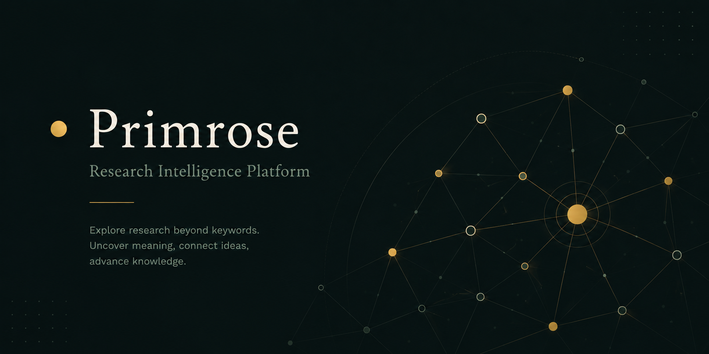

# Primrose

> Research intelligence. 




🌸 **Live application:** https://primroses.vercel.app

Primrose is an AI-powered research exploration platform built to make scientific literature easier to navigate.

It combines semantic retrieval, neural reranking, and LLM-guided recommendations to help researchers discover not only relevant papers, but what to read next. Over time, Primrose will evolve into a research intelligence platform capable of surfacing emerging topics, discovering relationships between ideas, and building an interactive knowledge graph of scientific literature.

---

## Development Roadmap

| Stage | Status | Capability |
|-------|--------|------------|
| 1 | **Complete** | Semantic Discovery Foundation |
| 2 | **Complete** | Recommendation Engine |
| 3 | Planned | Topic Discovery |
| 4 | Planned | Entity Extraction |
| 5 | Planned | Relationship Discovery |
| 6 | Planned | Knowledge Graph |
| 7 | Planned | Research Intelligence Platform |

---

## Features
### Semantic Discovery

Research papers are embedded into a shared vector space using transformer models, allowing Primrose to retrieve conceptually related work even when papers share little vocabulary.

- Semantic search
- Related paper discovery
- Transformer embeddings (all-MiniLM-L6-v2)
- Qdrant vector search
- PostgreSQL metadata storage

### Reading Journey

Rather than returning only similar papers, Primrose generates a **Reading Journey**: a curated sequence of papers explaining what to read next and why.
The recommendation engine combines neural retrieval, reranking, and LLM reasoning while respecting the retriever's ranking.

- Cross-Encoder reranking
- AI-generated Reading Journeys
- Recommendation notes
- Educational paper sequencing

---
 

## Evaluation

***Manual evaluation with 7 representative queries:***

| Metric | Score |
|--------|-------|
| Precision@5 | 0.89 |
| MRR | 0.93 |
|nDCG@10| 0.91|

Most queries retrieved highly relevant papers with strong topical alignment. However, the pipeline still struggles with broad or emerging research topics when the corpus contains few directly relevant papers, occasionally returning tangential results. Since the reranker can only reorder retrieved candidates, its overall performance is ultimately constrained by the quality and coverage of the initial retrieval stage and the underlying research corpus.

---

## Architecture

```
                    React
                      │
                 FastAPI API
          ┌───────────┴───────────┐
          │                       │
     PostgreSQL               Qdrant
   Paper Metadata        Vector Embeddings
          ▲                       ▲
          └──── Embedding Worker ─┘
                      │
          Sentence Transformers
                      │
            Cross-Encoder Reranker
                      │
          Gemini Recommendation Engine
                      │
               Reading Journey
```

The API orchestrates retrieval while independent services handle embedding generation and recommendation.

See [ARCHITECTURE.md](./ARCHITECTURE.md) for full dataflow diagrams.

---

## Retrieval Pipeline

```
Query
   │
Sentence Transformer
   │
Qdrant ANN Search
   │
Top-k Candidates
   │
Cross-Encoder Reranker
   ├──────────────┐
   │              │
Related      Recommendation
 Papers          Engine
                    │
            Reading Journey
```

The retriever is responsible for finding relevant papers while the LLM is responsible for educational sequencing and recommendation quality

---

## Tech Stack

**Frontend** -- React, Vite, Axios

**Backend** -- FastAPI, SQLAlchemy, PostgreSQL, Qdrant, Sentence Transformers, Cross-Encoder, Google Gemini

**Infrastructure** -- Docker, Docker Compose

---

## Design Decisions

**Separate stores for metadata and vectors.** PostgreSQL handles structured metadata; Qdrant handles approximate nearest-neighbor search with HNSW indexing. Each store is used for what it does well.

**Background embedding worker.** Embedding generation does not block the request cycle. Documents are available for metadata queries immediately after ingestion and become searchable once the worker processes them.

**Semantic search over keyword matching.** The same concept appears under dozens of names in the research literature. Embedding-based retrieval captures intent rather than surface terms.

**Hybrid recommendation pipeline.*** Semantic retrieval identifies relevant papers, while Cross-Encoder reranking improves candidate quality. The LLM then converts retrieved papers into a coherent Reading Journey instead of acting as a second retriever.

---

## Running Locally

1. Create environment file:

```bash
cp backend/.env.example backend/.env
```

2. Start the development stack:

```bash
docker compose up --build
```

This starts:

| Service  | URL                        |
| -------- | -------------------------- |
| Frontend | http://localhost:5173      |
| API      | http://localhost:8000      |
| API Docs | http://localhost:8000/docs |

### Background Worker

The Docker Compose stack includes a background worker that continuously embeds newly added papers into Qdrant.

> **Deployment note:** The public demo performs embedding synchronously because Render's free tier does not support background worker services. The project retains a dedicated worker architecture for production deployments.
---

## Testing

Primrose keeps the development and test stacks separate. The test environment uses its own PostgreSQL container, its own Qdrant container, and a separate Qdrant collection name so the development database and vector store stay untouched.

### Start the test environment

```bash
docker compose --env-file .env.test -f docker-compose.test.yml up -d --build
```

This starts:

| Service | Purpose |
|--------|---------|
| `test-postgres` | Isolated PostgreSQL database for tests |
| `test-qdrant` | Isolated Qdrant instance for tests |
| `api-test` | App container used to run pytest |

### Run pytest

```bash
docker compose --env-file .env.test -f docker-compose.test.yml exec -T api-test python -m pytest
```

At test startup, pytest prints the PostgreSQL database and Qdrant collection it is using and refuses to run if they match the development environment.

### Destroy the test environment

```bash
docker compose --env-file .env.test -f docker-compose.test.yml down -v
```

The `-v` flag removes the isolated test volumes so the next run starts from a clean slate.

### Worker safety

The background worker will not run in test mode unless `ENABLE_WORKER_ON_TEST_DB=1` is set explicitly. This keeps integration tests from accidentally processing the test database in the background.

## API

| Method | Endpoint | Description |
|--------|----------|-------------|
| GET | /documents | List all documents |
| GET | /documents/{id} | Retrieve a single document |
| GET | /documents/search | Semantic search |
| GET | /documents/{id}/related | Related paper discovery |
| GET | /documents/{id}/recommendations | Reading Journey |
| POST | /documents | Ingest a new document |
| PUT | /documents/{id} | Update document metadata |
| DELETE | /documents/{id} | Remove a document |

`POST`, `PUT`, and `DELETE` currently serve developer and admin workflows and are not exposed in the frontend.

---

## Known Limitations

- General-purpose embedding model (domain-specific models planned)
- No user authentication or access control yet
- Frontend is read-only; corpus management requires direct API access
- Recommendation quality depends on the selected LLM
- Reading journeys are context-aware rather than user-personalized


---

## What's Next 

- Domain-specific embedding model (SPECTER2)
- User authentication and corpus management interface
- Topic discovery
- Topic clustering
- Citation graph integration
- Knowledge graph construction
---

## License

[CC BY-NC 4.0](./LICENSE) -- free to use and adapt, not for commercial purposes.