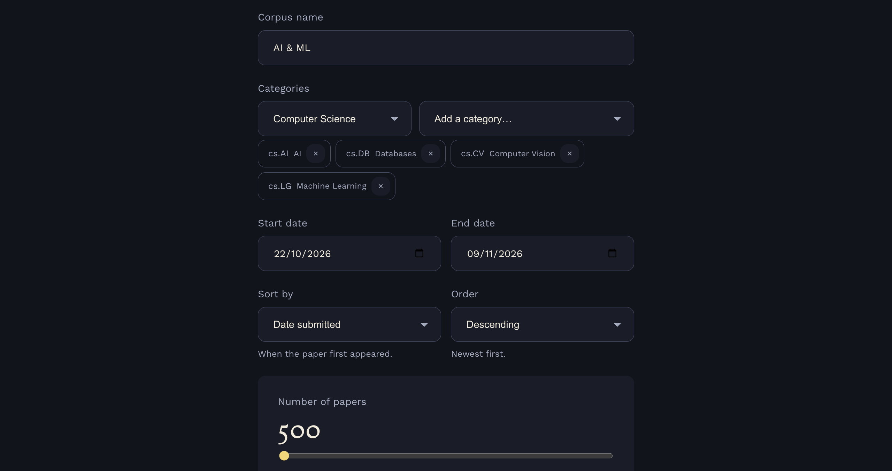
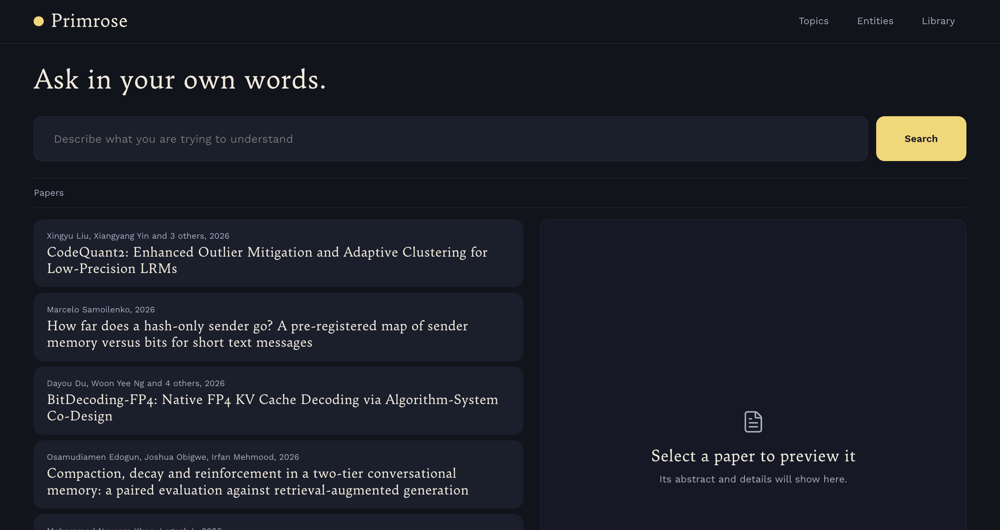
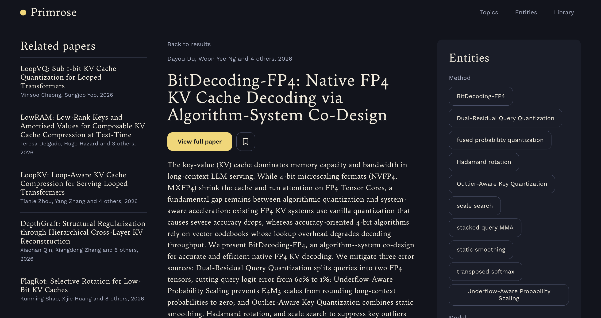
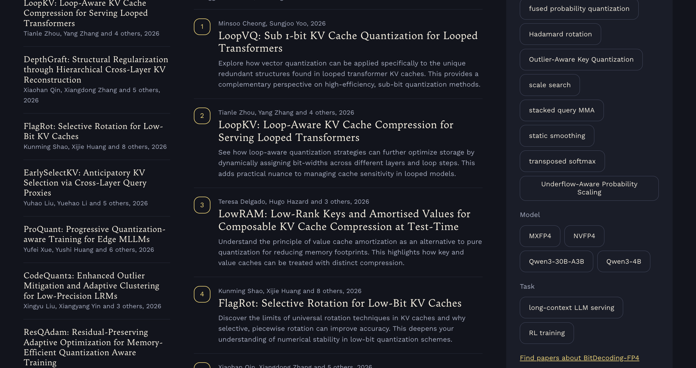

<div align="center">


# Primrose

### Your research, connected.

*Discover scientific literature, explore research topics, and find connections between papers; all in your own research workspace.*

<a href="https://github.com/shaizaiqubal/primrose/releases/latest/download/Primrose.zip">
  
</a>

<p>For Apple Silicon Macs · Requires Docker Desktop</p>


</div>

---

Primrose is a local-first research discovery platform built around the way you explore scientific literature. Create a research corpus from arXiv, discover connections between papers, explore emerging topics, and build reading journeys through related work.

Your corpus, your papers, your research workspace.

## Features

### Build your own research corpus

Create a corpus directly from arXiv, tailored to your research interests.

- Choose your own arXiv categories.
- Set custom start and end dates.
- Configure document limits and sorting preferences.
- Sync papers directly from arXiv.
- Explore your corpus through semantic search and research topics.




### Local-first research

Your research workspace runs locally on your machine.

After the initial corpus ingestion and processing, core functionality runs locally without requiring an external AI API or continuous internet connection.

- Local semantic search and paper retrieval.
- Local transformer embeddings and Cross-Encoder reranking.
- Locally stored papers, vectors, topics, and bookmarks.
- Your research data stays on your machine.

*External services are still used for corpus synchronization and optional AI-powered features such as topic naming and reading recommendations.*




### Add your own papers

Add papers beyond your arXiv corpus and discover where they fit into your research.

- Upload papers using their title and abstract.
- Find related papers from your existing corpus.
- Explore connections through semantic similarity.
- Keep personal uploads alongside your research library.




### Reading journeys

Go beyond a list of similar papers. Get a guided sequence of papers to help you understand a research area and decide what to read next.

- Semantic retrieval and Cross-Encoder reranking.
- Gemini-generated reading journeys.
- Explanations for recommended papers.
- Five-paper reading sequences.




### Research topic discovery

Explore your corpus through clusters of related papers rather than individual search results.

- K-Means clustering over paper embeddings.
- Automatically generated topic names.
- Topic pages with paper counts and representative papers.
- Browse research themes across your corpus.

### Personal library

Keep your research organized in one place.

- Bookmark papers for later.
- Manage your own uploaded papers.
- Explore papers across your corpus and personal library.


## Installation

Primrose is distributed as a macOS app. You do not need Python, Node.js,
Git, or the Primrose source code to use it.

### Requirements

-   A Mac with Apple Silicon
-   [Docker Desktop for
    Mac](https://www.docker.com/products/docker-desktop/)
-   An internet connection for the initial image downloads and services
    that use external APIs

### Install Primrose

1.  Download the latest `Primrose.zip` from the project's [GitHub
    Releases](https://github.com/shaizaiqubal/primrose/releases).
2.  Extract the ZIP.
3.  Move `PrimroseLauncher.app` into your **Applications** folder.
4.  Open Docker Desktop and wait until it is running.
5.  Open Primrose from Applications.

If macOS blocks the app because it was downloaded from the internet,
control-click `PrimroseLauncher.app`, choose **Open**, and confirm the
prompt. You may need to do this the first time.

> [!IMPORTANT]
> **Gemini API key required**
>
> Before creating your first corpus, configure a Gemini API key in Primrose's settings. Gemini is used for topic naming, entity recognition, and generating reading journeys and recommendations. Without a configured key, these features will not work.
>
> You can get an API key from [Google AI Studio](https://aistudio.google.com/apikey).
> 
### Start using Primrose

1.  Open the launcher.
2.  Select **Start Primrose**.
3.  Wait while the services start. The launcher waits for the API's
    Uvicorn startup message before marking startup complete.
4.  Select **Open** to open Primrose in your browser.
5.  Create an account and enter a your API key in the settings.
6.  Create your corpus and start researching!
7.  Use **Stop** in the launcher when you are finished.

Your papers and application data are stored in Docker volumes on your
Mac. The launcher starts the bundled production Compose configuration and
downloads the required container images on first use. Later starts reuse
the downloaded images unless an updated image is published.

## Development

The macOS launcher is a separate SwiftUI project; the application itself is made up of the
React frontend, FastAPI backend, and Docker Compose services.

### Requirements

-   Python 3.13
-   Node.js and npm
-   Docker Desktop or Docker Engine with Docker Compose v2

### Run the application locally

Clone the repository and start the development stack from the repository
root:

``` bash
git clone https://github.com/shaizaiqubal/primrose.git
cd primrose
docker compose up --build
```

The development Compose configuration is `docker-compose.yaml`. The
self-hosted production configuration used by the launcher is
`primrose-installer/docker-compose.prod.yaml`.

To stop the development stack:

``` bash
docker compose down
```

This keeps named volumes. Add `-v` only when you deliberately want to
delete the local development data.

### Testing

The test stack is isolated from the development database and Qdrant
instance.

Start it:

``` bash
docker compose --env-file .env.test -f docker-compose.test.yml up -d --build
```

Run the test suite:

``` bash
docker compose --env-file .env.test -f docker-compose.test.yml exec -T api-test python -m pytest
```

Stop it:

``` bash
docker compose --env-file .env.test -f docker-compose.test.yml down
```

The test volumes are retained. Test fixtures reset the database and
Qdrant collection before each test run.

### Repository layout

``` text
backend/
  app/             FastAPI app, routes, models, schemas, security
  services/         Search, ingestion, embeddings, entities, topics, recommendations
frontend/           React + TypeScript application
alembic/            Database migrations
tests/              API, service, and integration tests
primrose-installer/ Production Compose configuration and installer
docker-compose.yaml Development services
```

### How the services fit together

-   **FastAPI** handles authentication, paper and corpus APIs, semantic
    search, topics, entities, and recommendations.
-   **PostgreSQL** stores paper metadata, users, bookmarks, corpus
    records, and topic assignments.
-   **Qdrant** stores document vectors used for semantic retrieval.
-   **Redis** carries background jobs through streams and caches
    frequently requested topic and recommendation data.
-   **Embedding worker** creates document embeddings and writes them to
    Qdrant.
-   **Entity worker** extracts paper entities and stores the results in
    PostgreSQL.
-   **Topic naming worker** uses Gemini to label topic clusters.
-   **React** provides the browser interface.

Corpus sync fetches arXiv metadata, saves paper records, and publishes
embedding and entity jobs to Redis. Once corpus embeddings are ready,
topic clustering runs for that corpus and topic naming is queued
separately.

For the detailed service map, data flows, repository responsibilities,
and architecture boundaries, see [ARCHITECTURE.md](./ARCHITECTURE.md).

## Technology
| Area | Technologies |
| --- | --- |
| Frontend | React, TypeScript, Vite |
| API | Python, FastAPI, SQLAlchemy |
| Relational data | PostgreSQL |
| Vector search | Qdrant |
| Background jobs and cache | Redis streams, Redis cache |
| Embeddings and reranking | Sentence Transformers, Cross-Encoder |
| Recommendations and topic labels | Google Gemini |
| Paper source | arXiv |
| Local deployment | Docker Compose |

## License

[CC BY-NC 4.0](./LICENSE). Free to use and adapt, not for commercial purposes.
